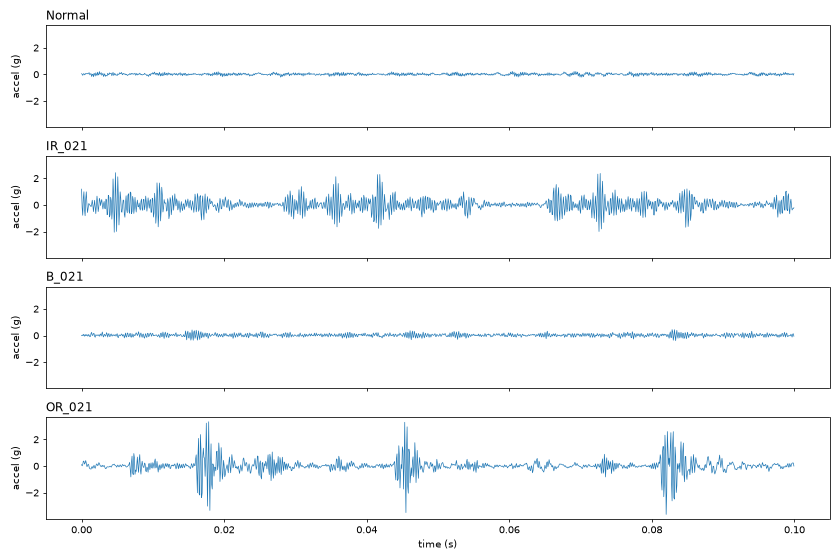
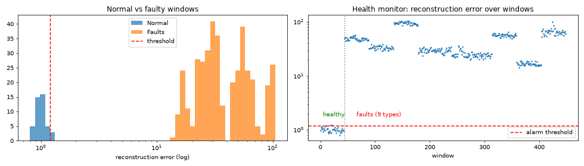

# 🔧 Bearing Fault Detection from Vibration (Predictive Maintenance)


> I used to fix machines **after** they broke. This project predicts the failure **before** it happens.

An accelerometer on a motor bearing records vibration 12,000 times per second. A crack makes a small "hit" every time a ball rolls over it. The goal is to recognize these patterns **before** the bearing fails.
10 classes: healthy + 3 fault locations (inner race, ball, outer race) × 3 fault sizes.

| Data | Key result |
|---|---|
| CWRU vibration signals | Autoencoder trained on **healthy data only**: detects **100%** of faults with **0.9%** false alarms |

📓 [`bearing_faults_full.ipynb`](bearing_faults_full.ipynb)



## What I did

- **Leak-free split by time:** each recording is split 60/20/20 **before** cutting it into windows, so overlapping windows never appear in both train and test.
- **Classic ML baseline:** 26 physics-inspired features (RMS, kurtosis, crest factor, FFT band energies) + Random Forest.
- **1D CNN** on raw signal windows, with a wide first kernel.
- **Autoencoder for anomaly detection**, trained on **healthy data only**, which is the realistic case in a factory, where fault examples are rare. A high reconstruction error raises an alarm.
- **Robustness test** on new recordings at a different motor load (1 HP).



| Model | Same load (0 HP) | New load (1 HP) | New load, fault *location* only |
|---|---|---|---|
| Random Forest + features | 100% | 86.6% | **99.4%** |
| 1D CNN | 96.3% | 74.9% | 84.2% |

**Autoencoder at the new load:** detects **100%** of faults with **0.9%** false alarms, after calibrating the alarm threshold on a short healthy baseline (no fault data used).

## Problems I found and fixed

- 🐛 **A hidden data bug:** the healthy recordings are sampled at **48 kHz**, the fault recordings at **12 kHz**. I found it with physics: the shaft frequency (1796 RPM / 60 ≈ 30 Hz) only appears in the right place at 48 kHz. Without resampling, models learn a shortcut ("slow-looking signal = healthy").
- 🎚️ **Alarm threshold:** trained at one load, the autoencoder flagged *every* healthy window at a new load, but healthy (error ≈ 5) and faulty (error ≥ 22) were still clearly separated. The fix is to calibrate the threshold per operating condition, like commissioning a real monitoring system.
- 📉 **Simple beats deep here:** with ~10 s of data per class, physics-based features + Random Forest generalize better to a new load than the CNN.

## Limits & next steps

CWRU faults are artificially made on a lab test rig, and the data shows *fault vs. no fault*, not *time until failure*. The next step is a run-to-failure dataset (IMS, PRONOSTIA) for Remaining Useful Life prediction.

## Run the notebook

```bash
git clone https://github.com/muemara1/bearing-fault-detection.git
cd bearing-fault-detection
python -m venv .venv
# Windows: .venv\Scripts\activate    Linux/macOS: source .venv/bin/activate

# For an NVIDIA GPU, install the CUDA build of torch first (see pytorch.org)
pip install -r requirements.txt
jupyter notebook bearing_faults_full.ipynb
```

**Data** (not stored in the repo): download from the [CWRU Bearing Data Center](https://engineering.case.edu/bearingdatacenter), files 97–234 (0 HP) and 98–235 (1 HP), drive end, 12k, and put them in `data/cwru/<number>.mat`.

> **AMD GPU note:** on ROCm under Windows, MIOpen may fail to compile its BatchNorm kernel.
> The notebook sets `torch.backends.cudnn.enabled = False` to use PyTorch's built-in kernels instead.

## Credits

Dataset: [CWRU Bearing Data Center](https://engineering.case.edu/bearingdatacenter), Case Western Reserve University.

---

More of my work: [github.com/muemara1](https://github.com/muemara1)
